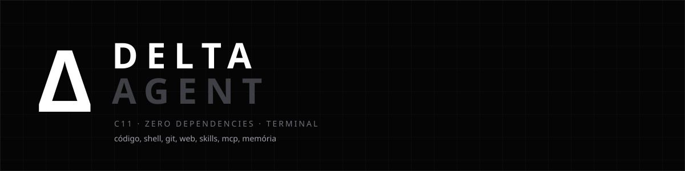

<p align="center">
  
</p>

<p align="center">
  <a href="https://github.com/descz/delta/releases/latest"></a>
  
  
  
  
  
  
  <a href="LICENSE"></a>
</p>

> **License:** source is available for study and personal/internal use — **selling or cloning is
> prohibited**, and any public disclosure must be **non-profit** and **credited** to the project.
> See [LICENSE](LICENSE).

**Delta Agent** is a coding agent that lives in your terminal.
Site: **[descz.github.io/delta](https://descz.github.io/delta/)** · downloads: **[Releases](https://github.com/descz/delta/releases/latest)**

You talk in natural language and it does the work: reads and writes files, runs commands, handles
git, searches the web, keeps memory and explains what it found — with the model you choose.

It is a **single executable written in C11, with no dependencies at all**: no Node, Python, npm, pip
or framework installer. On Windows it is **544 KB** and about **1.7 MB of private memory**.

---

## Table of contents

- [What it does](#what-it-does)
- [Install](#install)
- [First steps](#first-steps)
- [Commands and shortcuts](#commands-and-shortcuts)
- [How it works](#how-it-works)
- [Where your data lives](#where-your-data-lives)
- [Build from source](#build-from-source)
- [Tests](#tests)
- [Project structure](#project-structure)
- [License](#license)

---

## What it does

| | |
|---|---|
| **Files** | reads, creates, edits precisely (exact-block `edit`), searches the project, shows diffs |
| **Shell** | runs commands, keeps background jobs, `/terminal` shows the output in a chat block |
| **Git** | status, diff, log, commit and *checkpoint* before changing anything |
| **Web** | downloads pages, extracts data, reads documentation — and speaks **MCP** over HTTP or stdio |
| **Skills** | saved workflows in `SKILL.md`, indexed in the system prompt and reused |
| **Memory** | durable facts across sessions, searchable by text |
| **Project graph** | indexes symbols and imports once, then answers without re-reading every file |
| **Models** | [models.dev](https://models.dev) catalog with hundreds of models and providers |
| **Sessions** | per-folder history in JSONL; `delta` resumes that folder's last chat |
| **Streaming** | token by token, cut immediately when you send a message mid-turn |

All inside the terminal, with its own TUI: mouse selection and copy, rendered markdown (headings,
lists, code, tables), OkLCH colors, themes, i18n (pt, en, es, zh, ja) and an installer with an HTML
screen served **by the executable itself**.

## Install

Download from [**Releases**](https://github.com/descz/delta/releases/latest). Each system has one file
that already is the installer:

| system | file | how |
|---|---|---|
| **Windows 10/11 x64** | `Delta-windows-x64.zip` (or `Delta.exe`) | double click → install screen in the browser |
| **Linux x86_64** | `delta-linux-x86_64.run` | `chmod +x delta-linux-x86_64.run && ./delta-linux-x86_64.run` |
| **macOS 11+** | `delta-macos-source.zip` | unzip and double click `INSTALAR-MAC.command` |

The installer asks **where to keep the data**, creates the folder, copies the binary, puts `delta` on
the `PATH` and creates the shortcut (taskbar on Windows, `.desktop` + GNOME favorites on Linux,
`Delta.app` + Dock on macOS). Windows may warn on SmartScreen the first time (*More info → Run
anyway*) because the binary is not code-signed.

There is no ready-made macOS binary: the package ships the source and a `.command` that checks the
Xcode Command Line Tools (free), builds and opens the installer — there is no reliable cross-compile
to Mach-O.

## First steps

```text
$ delta
sem chave de API · use /login para colar a chave do provedor

/login                          # pick the provider, paste the key, get a default model
/projects D:\dev\my-app         # where it works (saved for next time)
read src/main.c and explain the flow
```

Next time, `delta` opens **in that folder's last chat**. `delta --new` starts fresh.

## Commands and shortcuts

| command | what it does |
|---|---|
| `/login` `/logout` | connect/disconnect providers (one key per provider) |
| `/models` | models from connected providers |
| `/thinking` | reasoning effort (off → max, depending on the model) |
| `/projects <folder>` | set the working folder (saved in config) |
| `/terminal <cmd>` | runs in your shell and shows the output in the chat |
| `/copy` | copies the last reply |
| `/undo [file]` | restores a file to its content before the last edit |
| `/update` | installs the newest version from GitHub (the app warns at startup when one exists) |
| `/forlimit [n]` | toggles a tools-per-turn cap (run again to turn it off) |
| `/status` `/session` | configuration, usage and session |
| `/new` `/clear` `/reload` `/quit` | new session, clear, reload, quit |
| `/help` | all of it on screen |

`delta wiki` opens the documentation in the browser; `delta --setup` reopens the installer.
`delta update` does the same job without opening the app: `delta update --check` only reports, and
the command replaces the running executable in place (on Windows it is renamed, so the file can be
swapped while it runs). The TUI checks for a new release once a day and shows a notice at startup;
turn that off with `"updateCheck": false` in `config.json` or `DELTA_NO_UPDATE_CHECK=1`.

| key | action |
|---|---|
| `Enter` / `Shift+Enter` | send / new line |
| `Ctrl+C` | stops the generation (never closes the app) |
| `Ctrl+X` | copies the last reply |
| `Ctrl+Q` | returns the last queued message to the editor |
| mouse | click selects a whole message (`Ctrl+X` copies it, without the box); drag selects text and copies on release; wheel scrolls the conversation |
| `Esc` | clears the selection and jumps to the end |

**Typing while it works is supported**: the message appears in the chat marked *queued* and the agent
**cuts the reply mid-stream** to read it — no waiting for the final message.

## How it works

A turn is: *prompt → model (streaming) → tool calls → result → next step*, until the model stops.
Delta owns the loop and the tools; the model only asks.

- **Own renderer** (`ui.c`): cell grid with OkLCH colors (faithful port of OkLch/OkHsl), markdown →
  `Doc` of styled lines, tool boxes, multi-line editor with cursor. The transcript is rebuilt
  **incrementally**, block by block (`tr_y`/`tr_fast_from`), keeping a frame at ~0.5 ms even in long
  conversations.
- **Terminal** (`term.c`): raw mode with `ReadConsoleInput` on Windows and `termios` on POSIX; mouse
  (click, wheel, drag), paste, resize, alternate screen and modified-key shortcuts.
- **Network** (`provider.c`): WinHTTP on Windows, `curl` on POSIX — SSE read line by line, with
  mid-stream *abort* when you step in.
- **Agent** (`agent.c`): typed history (`user`/`assistant`/`tool`), tool calls with ids, JSONL v3
  sessions per folder, system prompt rebuilt every turn (with skills indexed and the project graph).
- **Project graph** (`codegraph.c`): indexes files, symbols and imports once into
  `~/.deltaCore/graphs/<slug>.graph`; the agent queries it with the `graph` tool instead of reading
  the whole codebase on every input.
- **Tools** (`tools.c`, `tools_ext.c`): 40+ operations grouped in families (`fs`, `shell`, `git`,
  `web`, `skills`, `mcp`, `memory`, `code`, `assert`, `agent`, `extend`), with timeouts, output
  limits and console encoding conversion. Every write keeps an undo snapshot.
- **Installer** (`setup.c`): local HTTP server (Winsock/Berkeley) serving an embedded page
  (~13 KB, fonts in base64), opens the browser and performs the install — native folder picker,
  binary copy, `PATH`, shortcuts and pinning.

The look (themes, color tokens, sizes) follows the same vocabulary as a modern editor: 56 theme
tokens, plain `.json` files in `themes/`.

## Where your data lives

One folder, chosen at install time (default `C:\Users\<you>\.deltaCore`):

```
.deltaCore/
  config.json        provider, model, language, thinking, projectDir
  auth.json          one API key per provider
  models.v2.json     cached models.dev catalog
  memory.json        durable memory
  sessions/          --<folder-slug>--/<date>_<id>.jsonl
  skills/            <name>/SKILL.md
  mcps/              one .json per MCP server (url or command)
  extensions/        pluggable extensions
  graphs/            project graph cache (symbols/imports)
  update.json        last release check (version, asset, timestamp)
  system/prompt.md   rules it must always follow
  paste/ jobs/ themes/ undo/
```

`system/prompt.md` is re-read every turn: that is where you write your team rules.

## Build from source

You only need a C compiler and the system libc.

**Windows** (MinGW-w64 / Git Bash):

```bat
build.bat            :: bin\delta.exe
package.bat          :: dist\Delta.exe + zip
```

**Linux / macOS**:

```bash
./build.sh           # bin/delta
./build.sh --test    # + core tests
./package.sh         # tarball + .run (Linux) | .app + zip + dmg (macOS)
```

On macOS the Xcode Command Line Tools (`xcode-select --install`) are enough. At runtime Linux uses
`curl` to talk to the provider.

## Tests

Two suites, no framework:

```bash
bash tests/run_all.sh     # Windows: 60+ checks (TUI replay, provider mock, installer)
bash tests/run_posix.sh   # Linux/macOS: build, core, replay, real streaming, installer, docs
```

The **replay** mode runs the real application without a terminal (`--replay script.txt 110 36`) and
dumps the screen as text — that is how the TUI is tested in CI. The fake provider
(`tests/mock_openai.py`) covers streaming, tool calls, HTTP errors, retries and mid-stream steering.

## Project structure

```
src/
  main.c        TUI, commands, editor, transcript
  agent.c       agent loop, sessions, system prompt, config/auth
  provider.c    streaming (WinHTTP / curl), tool calls, token usage
  codegraph.c   project graph: files, symbols, imports
  tools.c       fs, shell, git, diff, web, undo
  tools_ext.c   skills, mcp (HTTP/stdio), memory, code, assert, agent, extend
  setup.c       installer (local server + embedded HTML screen)
  ui.c          cell grid, markdown, components
  term.c        terminal (Win32 / POSIX)
  theme.c okcolor.c  themes and OkLCH colors
  clipboard.c   paste (text, image, files)
  json.c util.c i18n.c extensions.c modelsdev.c
installer/      installer page (embedded in the exe)
docs/           landing page (GitHub Pages)
assets/         logo, hero, screenshots
tests/          replay scripts + mocks + suites
```

## License

**Source-available, non-commercial.** The source is public for study and personal/internal use, but
the license **forbids selling, renting, paid access and cloning** — and requires credit to the
product in any public disclosure.

| allowed | forbidden |
|---|---|
| use, study and modify for personal, educational or internal use | sell, rent, charge for access, include in a paid product/service |
| share the **unmodified** copy, non-profit | publish a public fork, mirror, package, binary or **clone/rebrand** |
| cite, write, record videos — **with credit** | removing credits, the name, the Δ symbol or this notice |

Mandatory credit: **Delta Agent — https://github.com/descz/delta**.
Commercial permission, cloning or special redistribution: open an issue in the repository.
